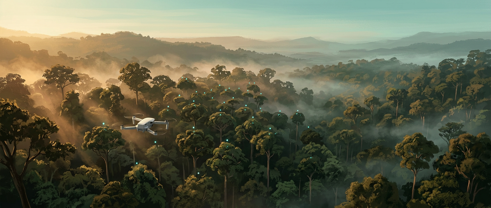

# Karbon Hutan Bisa Dihitung dari Udara

## Pertanyaan yang Bikin Bingung: Hutan Ini Simpan Berapa Ton Karbon?

Bayangkan kamu baru selesai memetakan 200 hektar hutan dengan drone. Fotonya tajam, ortofotonya mulus. Lalu klien bertanya satu hal sederhana: "Jadi, hutan ini menyimpan berapa ton karbon?"

Di titik ini banyak pilot drone terdiam. Orang kehutanan juga sering bingung, tapi dengan alasan berbeda. Mereka tahu cara mengukur pohon di lapangan, tapi tidak terbayang mengukur puluhan ribu pohon satu per satu.

Pertanyaan soal karbon makin sering muncul, dan bukan cuma dari peneliti:

- **Perusahaan** yang ingin melaporkan jejak karbon dan upaya penyerapannya.
- **Pengelola proyek karbon** yang butuh angka dasar sebelum proyek berjalan.
- **Pemerintah daerah dan pengelola kawasan** yang memantau kondisi hutan dari tahun ke tahun.
- **Pemilik kebun dan hutan rakyat** yang ingin tahu nilai lingkungan lahannya.

Semuanya butuh **angka**, bukan perkiraan. Jawaban "kira-kira banyaklah" tidak bisa dimasukkan ke laporan. Angka yang terlalu tinggi bisa dianggap menyesatkan, dan angka yang terlalu rendah membuat nilai hutan terlihat kecil.

Kabar baiknya, kamu tidak perlu memilih antara "mengukur semua pohon" dan "menebak". Ada jalan tengah yang sudah dipakai di banyak proyek: **menghitung pohon dari udara, mengukur tinggi dan tajuknya dengan fotogrametri, lalu mengkalibrasinya dengan sedikit data lapangan.** Cara inilah yang akan kita pelajari di buku ini.

Selama bertahun-tahun mengerjakan perhitungan karbon dengan kombinasi tree counting dan fotogrametri, aku melihat pola yang sama. Orang biasanya tidak gagal karena rumusnya sulit. Mereka gagal karena tidak tahu urutan kerjanya. Setelah urutannya jelas, semuanya jadi masuk akal. Jadi bab ini kita pakai untuk melihat peta besarnya dulu.

## Di Mana Karbon Disimpan di Hutan

Pohon tumbuh dengan "makan" CO₂ dari udara. Lewat fotosintesis, karbon dari CO₂ diubah menjadi gula, lalu menjadi kayu, daun, dan akar. Kira-kira separuh berat kering sebuah pohon adalah karbon. Jadi semakin besar pohonnya, semakin banyak karbon yang tersimpan di dalamnya.

Panduan internasional (IPCC) membagi karbon hutan menjadi **lima kolam** (*carbon pools*):

| Kolam karbon | Isinya | Bisa dilihat drone? |
| --- | --- | --- |
| Biomassa atas tanah | Batang, cabang, daun pohon hidup | Ya, sebagian besar |
| Biomassa bawah tanah | Akar pohon hidup | Tidak, dihitung dengan rasio |
| Kayu mati | Pohon mati berdiri dan batang roboh | Sebagian |
| Serasah | Daun dan ranting gugur di lantai hutan | Tidak |
| Karbon organik tanah | Bahan organik di dalam tanah | Tidak |

Buku ini fokus pada **biomassa atas tanah** (AGB, *above-ground biomass*) karena kolam inilah yang paling besar pada hutan berpohon dan paling cocok diukur dari udara. **Biomassa bawah tanah** (BGB) juga akan kita tambahkan, tapi dengan rasio akar terhadap pucuk, bukan dengan menggali akar (Bab 9).

Kolam lain seperti serasah dan karbon tanah tetap penting, terutama di hutan gambut. Untuk mengukurnya, kamu butuh pengambilan sampel di lapangan dan analisis laboratorium, jadi di luar cakupan buku ini. Yang penting, kamu selalu menyebutkan kolam mana yang dihitung di laporanmu. Itu salah satu tanda laporan karbon yang jujur.

> **Tips:** Kalau klien bertanya "total karbon hutan", tanyakan balik: "Kolam mana saja yang mau dihitung?" Pertanyaan sederhana ini menyelamatkan kamu dari salah paham di akhir proyek.

## Cara Lama vs Cara Drone

Cara klasik menghitung karbon hutan adalah **inventarisasi lapangan**. Tim masuk ke hutan, membuat plot sampel, lalu mengukur diameter dan tinggi setiap pohon di plot. Data plot kemudian diolah dengan rumus untuk mendapatkan biomassa per hektar, lalu dikalikan ke seluruh luas hutan.

Cara ini akurat di dalam plot. Masalahnya ada di luar plot. Dengan beberapa plot kecil, kamu harus berasumsi hutan di sekitarnya mirip dengan plot. Padahal hutan jarang seragam. Ada bagian yang rapat, ada yang bekas tebangan, ada lembah dan punggungan. Semakin luas area, semakin besar risiko angkanya meleset.

Cara drone membalik logikanya:

| | Inventarisasi lapangan penuh | Tree counting + fotogrametri |
| --- | --- | --- |
| Pohon yang terukur | Hanya di plot | Hampir semua pohon tajuk atas |
| Sebaran data | Titik-titik plot | Seluruh area |
| Tenaga lapangan | Banyak | Sedikit, hanya untuk kalibrasi |
| Waktu per 100 ha | Berminggu-minggu | Beberapa hari terbang dan olah |
| Peta karbon | Kasar | Detail sampai per pohon |

Dari foto drone, kita mendapatkan dua hal penting. Yang pertama **posisi dan jumlah pohon** (tree counting). Yang kedua **tinggi dan lebar tajuk** setiap pohon (dari model tinggi tajuk hasil fotogrametri).

Tapi drone punya satu kelemahan besar: **drone tidak bisa melihat diameter batang**, padahal diameter adalah ukuran paling penting untuk rumus biomassa. Di sinilah plot lapangan tetap dibutuhkan, tapi jumlahnya jauh lebih sedikit. Plot dipakai untuk mencari hubungan antara yang terlihat dari udara (tinggi dan tajuk) dengan yang tidak terlihat (diameter dan biomassa).

Jadi cara drone tidak menghapus kerja lapangan. Cara drone membuat kerja lapangan jauh lebih efisien, dan hasilnya mencakup seluruh area, bukan hanya plot.

## Alur Besar: Foto, Pohon, Biomassa, Karbon

Sebelum masuk ke detail, mari lihat seluruh perjalanan dalam satu alur. Simpan alur ini di kepala, karena setiap bab berikutnya adalah satu langkah di dalamnya.

1. **Rencanakan dan terbangkan drone** (Bab 3 dan 4). Foto hutan dengan overlap tinggi supaya model 3D tajuk bisa dibentuk.
2. **Ambil data plot lapangan** (Bab 5). Ukur diameter, tinggi, dan jenis pohon di beberapa plot sampel.
3. **Olah foto menjadi ortofoto, DSM, DTM, dan CHM** (Bab 6). CHM, atau model tinggi tajuk, memberi tahu seberapa tinggi setiap bagian tajuk dari tanah.
4. **Hitung pohon dan ukur tajuknya** (Bab 7). Setiap puncak tajuk dihitung sebagai satu pohon, lengkap dengan tinggi dan lebar tajuknya.
5. **Ubah ukuran pohon menjadi biomassa** (Bab 2 dan 8). Pakai model dari data plot dan persamaan alometrik.
6. **Jumlahkan menjadi stok karbon** (Bab 9). Tambahkan akar, hitung per hektar, dan nyatakan ketidakpastiannya.
7. **Laporkan** (Bab 10). Sajikan angka, peta, metode, dan batasannya.

Kalau diringkas jadi satu kalimat: **foto drone → pohon → ukuran pohon → biomassa → karbon → CO₂.**

Mungkin terlihat panjang, tapi setiap langkah sebenarnya sederhana kalau dikerjakan satu per satu. Di bab berikutnya kita mulai dari bagian yang paling sering bikin orang takut, yaitu rumus. Tenang, kita hitung pelan-pelan dengan satu pohon dulu.

## Kesimpulan Bab

- Permintaan angka karbon hutan makin sering datang dari perusahaan, proyek karbon, pemerintah, dan pemilik lahan. Mereka butuh angka yang bisa dipertanggungjawabkan, bukan tebakan.
- Karbon hutan tersimpan di lima kolam. Buku ini fokus pada **biomassa atas tanah** dan menambahkan **biomassa akar** dengan rasio. Selalu sebutkan kolam mana yang kamu hitung.
- Inventarisasi lapangan akurat di plot, tapi lemah untuk area luas. **Tree counting + fotogrametri** mengukur hampir semua pohon di seluruh area.
- Drone tidak bisa melihat diameter batang, jadi **plot lapangan tetap dibutuhkan** sebagai kalibrasi, dengan jumlah yang jauh lebih sedikit.
- Alur besarnya: **foto drone → pohon → ukuran pohon → biomassa → karbon → CO₂.** Setiap bab berikutnya membahas satu langkah dari alur ini.
