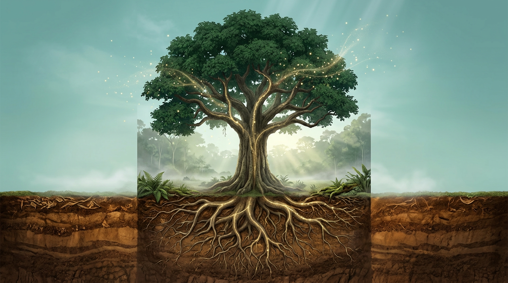

# Rumus Dasar dari Pohon ke Ton CO₂

## Biomassa: Berat Kering Sebuah Pohon

Semua perhitungan karbon dimulai dari satu kata: **biomassa**. Biomassa adalah berat kering bahan hidup. Untuk pohon, artinya berat batang, cabang, ranting, dan daun setelah semua airnya dihilangkan.

Kenapa harus berat kering? Karena kadar air pohon berubah-ubah. Pohon yang sama bisa lebih berat setelah hujan dan lebih ringan di musim kemarau. Karbonnya sendiri tidak berubah secepat itu. Dengan memakai berat kering, angka kita stabil dan bisa dibandingkan antarwaktu dan antarlokasi.

Cara paling akurat untuk mengetahui biomassa sebuah pohon adalah **menebang, memotong, mengeringkan, lalu menimbangnya**. Cara ini disebut metode destruktif. Para peneliti memang melakukannya, tapi hanya pada ratusan pohon contoh untuk membangun rumus. Kita jelas tidak akan menebang hutan hanya untuk mengetahui karbonnya.

Jadi kita butuh jalan pintas, yaitu cara **menaksir berat pohon dari ukurannya**. Logikanya mirip menaksir berat badan seseorang dari tinggi dan lingkar badannya. Tidak sempurna, tapi kalau rumusnya dibuat dari banyak data, hasilnya cukup dekat.

Ada tiga ukuran pohon yang paling berpengaruh pada biomassa:

| Ukuran | Simbol | Satuan | Diukur dari mana |
| --- | --- | --- | --- |
| Diameter setinggi dada (1,3 m) | D | cm | Lapangan, atau ditaksir dari tajuk (Bab 8) |
| Tinggi total pohon | H | m | Lapangan, atau dari CHM drone (Bab 6) |
| Berat jenis kayu | ρ (rho) | g/cm³ | Daftar berat jenis per jenis pohon |

Diameter adalah ukuran paling berpengaruh karena biomassa tumbuh jauh lebih cepat dari diameter. Pohon berdiameter 40 cm bukan dua kali lebih berat dari pohon 20 cm, melainkan jauh lebih berat. Karena itu kesalahan kecil pada diameter bisa membuat biomassa meleset banyak. Ingat ini, karena akan penting di Bab 8.

## Persamaan Alometrik, Jembatan dari Ukuran ke Berat

Rumus yang menghubungkan ukuran pohon dengan biomassanya disebut **persamaan alometrik**. "Alometrik" artinya hubungan antara ukuran bagian tubuh dengan ukuran keseluruhan. Persamaan ini dibuat dari data pohon yang benar-benar ditebang dan ditimbang.

Salah satu persamaan yang paling banyak dipakai untuk hutan tropis adalah persamaan **Chave dan kawan-kawan (2014)**. Persamaan ini dibangun dari ribuan pohon yang ditimbang di berbagai hutan tropis dunia:

> **AGB = 0,0673 × (ρ × D² × H)^0,976**

Keterangan:
- **AGB** = biomassa atas tanah satu pohon, dalam **kg**
- **ρ** = berat jenis kayu, dalam g/cm³
- **D** = diameter setinggi dada, dalam cm
- **H** = tinggi total pohon, dalam m
- **^0,976** = dipangkatkan 0,976

Jangan takut dengan pangkat 0,976. Angka ini sangat dekat dengan 1, jadi kamu bisa membayangkannya sebagai "kira-kira sebanding dengan ρ × D² × H". Spreadsheet atau kalkulator ilmiah bisa menghitung pangkat ini dengan mudah. Di Excel atau Google Sheets, tulis saja `=0.0673*(rho*D^2*H)^0.976`.

Kenapa D dikuadratkan? Karena luas penampang batang sebanding dengan diameter kuadrat. Kalau dikalikan tinggi, hasilnya kira-kira sebanding dengan volume batang. Volume dikali berat jenis memberi berat. Jadi rumus ini sebenarnya cukup masuk akal secara fisika.

Selain persamaan pantropis seperti Chave 2014, ada juga **persamaan lokal** yang dibuat untuk jenis pohon atau tipe hutan tertentu di Indonesia. Kalau tersedia persamaan lokal yang sesuai dengan lokasimu, persamaan itu biasanya lebih tepat. Yang penting, **tulis persamaan mana yang kamu pakai dan sumbernya** di laporan.

> **Tips:** Jangan memakai persamaan alometrik di luar rentang data pembuatnya. Persamaan yang dibuat dari pohon berdiameter 5–60 cm belum tentu cocok untuk pohon raksasa berdiameter 150 cm.

## Dari Biomassa ke Karbon ke CO₂

Setelah biomassa diketahui, dua langkah berikutnya sangat sederhana.

**Langkah 1: biomassa → karbon.** Tidak semua berat kering pohon adalah karbon. Sisanya oksigen, hidrogen, nitrogen, dan mineral. Nilai standar dari IPCC untuk kayu adalah **fraksi karbon 0,47**, artinya 47% biomassa adalah karbon.

> **Karbon (C) = AGB × 0,47**

**Langkah 2: karbon → CO₂.** Laporan iklim biasanya memakai satuan CO₂, bukan karbon murni, karena gas yang diserap dari udara adalah CO₂. Satu molekul CO₂ terdiri dari satu atom karbon (berat atom 12) dan dua atom oksigen (berat atom 16 × 2 = 32), jadi berat totalnya 44. Artinya, setiap 12 kg karbon setara dengan 44 kg CO₂.

> **CO₂ ekuivalen = C × 44/12** (atau kira-kira C × 3,67)

Jadi rangkaian lengkapnya seperti tangga:

1. **Ukuran pohon** (D, H, ρ)
2. ↓ persamaan alometrik
3. **Biomassa** (kg)
4. ↓ × 0,47
5. **Karbon** (kg C)
6. ↓ × 44/12
7. **CO₂ ekuivalen** (kg CO₂e)

Satuan juga perlu diperhatikan. Rumus alometrik menghasilkan kilogram, sedangkan laporan biasanya memakai **ton** (1 ton = 1.000 kg). Untuk area, satuan yang umum adalah **ton C per hektare** atau **ton CO₂e per hektare**. Salah satuan adalah kesalahan yang paling sering, dan dampaknya bisa membuat angka meleset seribu kali lipat.

## Latihan: Menghitung Karbon Satu Pohon

Sekarang kita praktik dengan satu pohon. Misalkan di plot lapangan kamu mengukur sebatang pohon meranti dengan data berikut:

| Ukuran | Nilai |
| --- | --- |
| Diameter setinggi dada (D) | 40 cm |
| Tinggi total (H) | 25 m |
| Berat jenis kayu (ρ) | 0,6 g/cm³ |

**Langkah 1: hitung ρ × D² × H**

0,6 × 40² × 25 = 0,6 × 1.600 × 25 = **24.000**

**Langkah 2: pangkatkan 0,976, lalu kalikan 0,0673**

24.000^0,976 ≈ 18.840

AGB = 0,0673 × 18.840 ≈ **1.268 kg** (sekitar 1,27 ton biomassa)

**Langkah 3: ubah ke karbon**

C = 1.268 × 0,47 ≈ **596 kg karbon**

**Langkah 4: ubah ke CO₂**

CO₂e = 596 × 44/12 ≈ **2.185 kg CO₂e** (sekitar 2,19 ton CO₂e)

Jadi satu pohon meranti setinggi 25 meter dengan diameter 40 cm menyimpan sekitar **2,2 ton CO₂e** di bagian atas tanahnya. Lumayan besar untuk satu pohon, kan?

**Coba sendiri:** hitung pohon kedua dengan D = 25 cm, H = 18 m, dan ρ = 0,5 g/cm³. Kalau hitunganmu benar, hasilnya sekitar **308 kg biomassa**, **145 kg karbon**, dan **530 kg CO₂e**. Perhatikan, diameternya hanya sekitar 60% dari pohon pertama, tapi CO₂-nya hanya sekitar seperempat. Itulah efek diameter kuadrat yang kita bahas tadi.

Sekarang bayangkan satu hektare hutan berisi ratusan pohon dengan ukuran berbeda-beda. Menghitung satu per satu dengan tangan jelas tidak mungkin. Karena itu, di bab-bab berikutnya kita akan membuat drone dan software mengerjakan bagian beratnya. Mulai dari menyiapkan perlengkapannya dulu.

## Kesimpulan Bab

- **Biomassa** adalah berat kering pohon. Kita tidak menimbang pohon, tapi menaksirnya dari **diameter (D), tinggi (H), dan berat jenis kayu (ρ)**.
- **Persamaan alometrik** menghubungkan ukuran dengan biomassa. Untuk hutan tropis, persamaan Chave 2014 banyak dipakai: **AGB = 0,0673 × (ρ × D² × H)^0,976**. Pakai persamaan lokal bila tersedia, dan selalu sebutkan sumbernya.
- Biomassa diubah ke karbon dengan **× 0,47**, lalu ke CO₂ dengan **× 44/12**.
- Diameter adalah ukuran paling berpengaruh. Kesalahan kecil pada diameter bisa membuat biomassa meleset besar.
- Contoh satu pohon (D 40 cm, H 25 m, ρ 0,6) menyimpan sekitar **1.268 kg biomassa, 596 kg karbon, atau 2,19 ton CO₂e**. Perhatikan selalu satuan kg, ton, dan per hektare.
