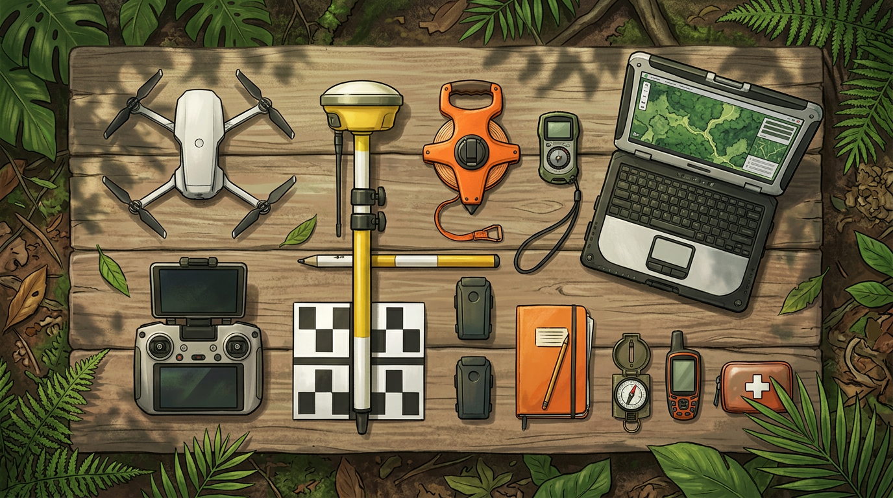

# Perlengkapan dan Software yang Kamu Butuhkan

## Drone dan Kamera yang Cocok untuk Hutan

Kabar baik untuk pilot drone pemula: **kamu tidak butuh drone LiDAR yang mahal** untuk metode di buku ini. Tree counting dan fotogrametri bekerja dengan **drone kamera RGB biasa**, asalkan kameranya cukup bagus dan posisinya tercatat dengan akurat.

Ada tiga hal yang perlu kamu perhatikan saat memilih drone.

**1. Kualitas kamera.** Yang penting bukan hanya jumlah megapiksel, tapi juga ukuran sensor. Sensor besar (1 inci ke atas) menghasilkan foto lebih tajam dan tidak banyak noise di bawah tajuk yang gelap. Kamera 20 megapiksel dengan sensor 1 inci atau 4/3 inci sudah sangat cukup.

**2. Jenis shutter.** Kamera dengan **mechanical shutter** (rana mekanis) merekam seluruh foto dalam waktu yang sama. Kamera dengan **rolling shutter** merekam baris demi baris, sehingga foto bisa sedikit "miring" saat drone bergerak cepat. Untuk pemetaan, mechanical shutter lebih aman. Kalau drone-mu rolling shutter, terbanglah lebih pelan dan aktifkan koreksi rolling shutter di software.

**3. RTK atau PPK.** Drone dengan modul **RTK** atau **PPK** mencatat posisi setiap foto dengan ketelitian sentimeter. Ini sangat membantu di hutan, karena memasang titik kontrol tanah (GCP) di bawah tajuk rapat itu sulit (Bab 4).

Contoh drone yang sering dipakai untuk pemetaan hutan:

| Kelas | Contoh | Catatan |
| --- | --- | --- |
| Ringkas, ekonomis | DJI Matrice 4 Enterprise (M4E) | Kamera 4/3 dengan mechanical shutter, mendukung RTK, mudah dibawa ke hutan |
| Pemetaan klasik | DJI Phantom 4 RTK | Banyak dipakai, suku cadang dan baterai mudah dicari |
| Area luas, resolusi tinggi | DJI Matrice 350 RTK + kamera Zenmuse P1 | Kamera full-frame 45 MP, cocok untuk ribuan hektare |
| Fixed-wing / VTOL | Berbagai merek | Jangkauan jauh, tapi butuh area lepas landas yang lebih luas |

Kalau kamu baru mulai dan anggarannya terbatas, drone kelas ringkas dengan RTK sudah cukup untuk proyek puluhan sampai ratusan hektare.

> **Tips:** Bawa baterai cadangan minimal tiga kali jumlah yang kamu kira cukup. Di hutan, kamu sering harus terbang ulang karena angin atau awan, dan lokasi pengisian daya biasanya jauh.

## Peralatan Lapangan untuk Plot Sampel

Ingat dari Bab 1: drone tidak bisa melihat diameter batang. Karena itu kamu tetap butuh peralatan lapangan untuk mengukur pohon di plot sampel (Bab 5).

| Alat | Fungsi | Alternatif murah |
| --- | --- | --- |
| **Pita diameter** (phi band) | Mengukur diameter batang setinggi dada langsung dalam cm | Meteran kain, lalu keliling dibagi 3,14 |
| **Clinometer atau hypsometer** | Mengukur tinggi pohon | Aplikasi clinometer di HP + meteran jarak |
| **GNSS RTK** Emlid Reach RS4 Pro | Mencatat koordinat GCP, check point, pusat plot, dan pohon; bisa juga dipakai sebagai base station | GPS HP, tapi akurasinya lebih rendah |
| **Meteran 30–50 m** | Mengukur jari-jari atau sisi plot | – |
| **Kompas** | Menentukan arah saat membuat plot | Kompas di HP |
| **Pita penanda (flagging tape)** | Menandai batas plot dan pohon yang sudah diukur | Tali rafia berwarna |
| **Tablet atau tally sheet** | Mencatat data pohon | Buku catatan tahan air |
| **Target GCP** | Titik kontrol yang terlihat dari udara | Papan kotak hitam-putih buatan sendiri |

Jangan lupa perlengkapan keselamatan: kotak P3K, sepatu lapangan, air minum, dan rekan kerja. Sebaiknya jangan pernah masuk hutan sendirian.

Satu alat yang sering dilupakan adalah **daftar berat jenis kayu**. Kamu butuh nilai berat jenis untuk setiap jenis pohon (Bab 2). Siapkan sebelum ke lapangan, misalnya dari basis data berat jenis kayu global atau literatur kehutanan Indonesia, supaya tim di lapangan tahu jenis apa saja yang harus dicatat dengan benar.

## Software Pengolahan dari Foto sampai Peta

Alur kerja di buku ini butuh empat jenis software. Untuk setiap jenis, ada pilihan berbayar dan gratis.

**1. Fotogrametri: mengubah foto jadi model 3D dan ortofoto.**
- **Agisoft Metashape Professional** (berbayar). Yang aku pakai di buku ini karena stabil, lengkap, dan bisa diotomatisasi dengan skrip Python.
- **WebODM / OpenDroneMap** (gratis, open source). Bagus untuk mulai belajar tanpa biaya lisensi.
- **Pix4Dmapper** atau **DJI Terra** (berbayar). Alternatif yang juga banyak dipakai.

**2. GIS: mengolah raster dan peta.**
- **QGIS** (gratis). Dipakai untuk membuat CHM, memotong area, menghitung statistik, dan membuat layout peta.

**3. Tree counting: mendeteksi pohon.**
- **lidR** (paket gratis untuk bahasa R). Bisa mendeteksi puncak pohon dan membuat batas tajuk langsung dari CHM.
- **DeepForest** (paket gratis untuk Python). Mendeteksi tajuk pohon dari ortofoto RGB dengan model AI yang sudah dilatih.
- **Plugin dan tool di QGIS** untuk deteksi puncak lokal, kalau kamu belum mau belajar coding.

**4. Perhitungan: rumus biomassa dan karbon.**
- **Excel atau Google Sheets** sudah cukup untuk menghitung biomassa dan karbon dari tabel pohon.
- **Python atau R** kalau jumlah pohonnya puluhan ribu dan kamu ingin semuanya otomatis.

Kebutuhan komputernya cukup berat untuk fotogrametri hutan. Sebagai patokan:

- RAM **32 GB** (64 GB untuk proyek ratusan hektare)
- Kartu grafis **NVIDIA dengan VRAM 8 GB** atau lebih
- **SSD** minimal 1 TB untuk data kerja

## Paket Minimal untuk Mulai

Kamu tidak harus membeli semuanya sekaligus. Ini tiga paket yang bisa kamu pilih sesuai tahap belajarmu.

| Paket | Isi | Cocok untuk |
| --- | --- | --- |
| **Belajar** | Drone kamera yang sudah kamu punya + WebODM + QGIS + spreadsheet + pita diameter | Latihan di kebun atau hutan kecil, memahami alur |
| **Proyek pertama** | Drone dengan RTK + Metashape (atau WebODM) + QGIS + lidR/DeepForest + alat plot lengkap | Proyek puluhan sampai ratusan hektare untuk klien |
| **Profesional** | Drone RTK kelas atas atau kamera full-frame + Metashape + komputer workstation + tim lapangan terlatih | Proyek ribuan hektare dan pemantauan rutin |

Saranku: mulailah dari paket **Belajar**. Coba terbang di area kecil, misalnya 5–10 hektare kebun atau hutan kota. Buat CHM, hitung pohonnya, lalu bandingkan dengan hitungan manual. Pengalaman satu proyek kecil yang tuntas jauh lebih berharga daripada membeli alat mahal tanpa paham alurnya.

Setelah alat siap, langkah berikutnya adalah merencanakan penerbangan. Di hutan, aturan terbangnya sedikit berbeda dari pemetaan biasa, dan perbedaan kecil itu menentukan apakah data kamu bisa dihitung atau tidak.

## Kesimpulan Bab

- Metode ini cukup memakai **drone kamera RGB**. Utamakan sensor yang cukup besar, **mechanical shutter**, dan **RTK/PPK** supaya posisi foto akurat tanpa banyak GCP.
- Peralatan lapangan tetap wajib untuk plot sampel: **pita diameter, clinometer, GNSS RTK Emlid Reach RS4 Pro, meteran, penanda plot**, dan **daftar berat jenis kayu**.
- Software terbagi empat: **fotogrametri** (Metashape atau WebODM), **GIS** (QGIS), **tree counting** (lidR atau DeepForest), dan **perhitungan** (spreadsheet atau Python/R).
- Fotogrametri hutan butuh komputer yang cukup kuat: RAM 32 GB, GPU NVIDIA 8 GB, dan SSD.
- Mulailah dari **paket Belajar** di area kecil, lalu naik ke paket berikutnya setelah alurnya kamu kuasai.
