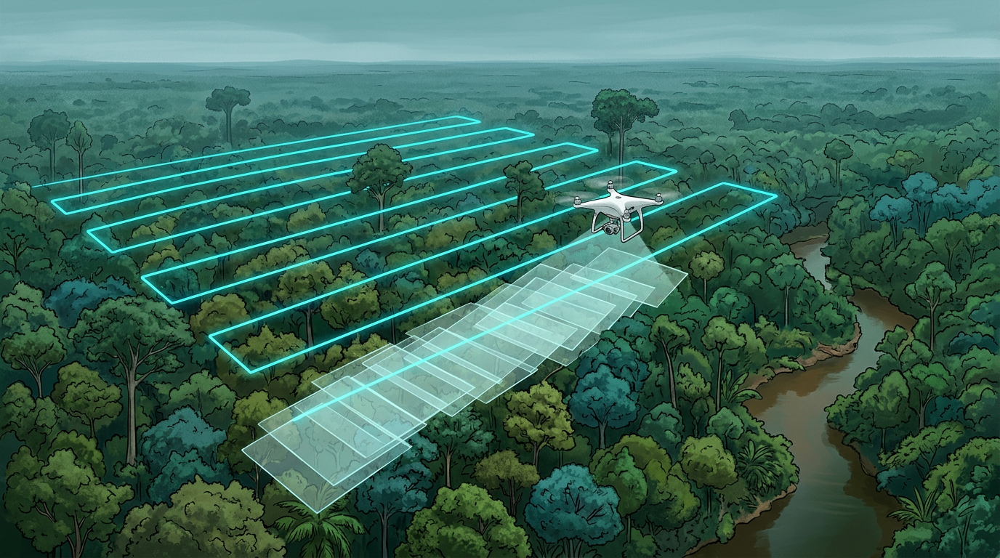

# Merencanakan Terbang untuk Hutan

## GSD: Seberapa Detail Foto yang Kamu Butuhkan

Langkah pertama merencanakan terbang adalah menentukan **GSD** (*Ground Sampling Distance*). GSD adalah ukuran satu piksel foto di dunia nyata. GSD 3 cm berarti satu piksel foto mewakili 3 × 3 cm di permukaan tajuk.

Untuk tree counting, kamu butuh foto yang cukup detail supaya batas antartajuk terlihat, tapi tidak perlu sedetail inspeksi bangunan. Patokan yang aku pakai:

| Tujuan | GSD yang disarankan |
| --- | --- |
| Tree counting di hutan tanaman atau kebun | 3–5 cm |
| Tree counting di hutan alam yang rapat | 2–4 cm |
| Hanya ortofoto gambaran umum | 5–10 cm |

GSD ditentukan oleh kamera dan ketinggian terbang:

> **GSD (cm) = (lebar sensor mm × tinggi terbang m × 100) ÷ (focal length mm × lebar foto piksel)**

**Contoh:** kamera dengan lebar sensor 17,3 mm, focal length 12,29 mm, dan lebar foto 5.280 piksel (kelas kamera drone pemetaan ringkas):

| Tinggi terbang | GSD |
| --- | --- |
| 80 m | ±2,1 cm |
| 100 m | ±2,7 cm |
| 120 m | ±3,2 cm |

Aplikasi perencanaan terbang biasanya menghitung GSD otomatis. Tapi ada satu hal yang sering terlupa: **tinggi terbang diukur dari mana?** Di hutan, tajuk bisa 30–40 meter di atas tanah. Kalau drone terbang 100 m di atas tanah, jaraknya ke puncak tajuk hanya 60–70 m. Hasilnya GSD di tajuk lebih kecil dari perkiraan, dan overlap antarfoto di tajuk menjadi lebih sedikit dari yang direncanakan.

Jadi selalu hitung dengan **jarak ke puncak tajuk**, bukan ke tanah. Dan selalu patuhi batas ketinggian terbang drone dari regulasi penerbangan yang berlaku.

## Overlap Tinggi, Wajib di Hutan

Fotogrametri bekerja dengan mencocokkan titik yang sama di beberapa foto. Di jalan atau bangunan, ini mudah karena polanya tegas. Di hutan, semua terlihat hijau, daun mirip satu sama lain, dan tajuk bergerak sedikit tertiup angin. Software jadi kesulitan menemukan titik yang cocok.

Solusinya adalah **overlap tinggi**. Dengan lebih banyak foto yang melihat titik yang sama, peluang software menemukan pasangan titik jadi jauh lebih besar.

| | Pemetaan biasa | Hutan (saran) |
| --- | --- | --- |
| Overlap depan (searah terbang) | 70–75% | **80–90%** |
| Overlap samping (antarjalur) | 60–65% | **70–80%** |

Konsekuensinya, jumlah foto bisa dua kali lipat dan waktu olahnya lebih lama. Tapi ini jauh lebih murah daripada terbang ulang karena model 3D tajuknya bolong.

Tips lain untuk hutan:

- **Terbang sedikit lebih tinggi** justru sering membantu. Setiap foto mencakup lebih banyak tajuk, sehingga lebih mudah dicocokkan, asalkan GSD masih masuk target.
- **Pakai mode terrain follow** di daerah berbukit, supaya jarak ke tajuk tetap stabil.
- **Lebihkan area terbang** 1–2 jalur di luar batas proyek. Tepi area selalu punya overlap paling sedikit dan kualitas paling rendah.
- **Kecepatan terbang** jangan terlalu tinggi, terutama untuk kamera rolling shutter.

## Waktu, Cahaya, dan Angin

Hutan punya dua musuh utama saat difoto dari udara: **bayangan** dan **gerakan**.

**Bayangan.** Saat matahari rendah, pagi atau sore, tajuk pohon tinggi membuat bayangan panjang di atas tajuk yang lebih rendah. Bagian yang tertutup bayangan menjadi gelap dan sulit dicocokkan. Pohon yang kecil juga bisa "hilang" di dalam bayangan. Waktu terbaik biasanya sekitar **pukul 10.00–14.00**, saat bayangan paling pendek.

Langit **mendung tipis yang merata** justru sering ideal. Cahayanya lembut dan bayangan hampir tidak ada. Yang harus dihindari adalah awan yang bergerak, karena membuat sebagian foto terang dan sebagian gelap.

**Gerakan.** Daun dan ranting bergerak saat angin bertiup. Di dua foto yang diambil dengan selisih satu detik, posisi daun bisa sudah berbeda. Software melihatnya sebagai titik yang tidak konsisten. Hasilnya tajuk terlihat kabur di ortofoto dan permukaannya kasar di model 3D.

Patokan praktis: kalau ranting di puncak pohon terlihat bergoyang dari bawah, tunda terbang. Angin biasanya lebih tenang di pagi hari menjelang siang. Catat juga kondisi cuaca di setiap penerbangan, supaya kamu bisa menjelaskan kalau ada bagian data yang kurang bagus.

## GCP dan Check Point di Area Berhutan

**GCP** (*Ground Control Point*) adalah titik di tanah yang koordinatnya diukur dengan GNSS RTK (aku memakai Emlid Reach RS4 Pro), lalu dipakai untuk mengikat hasil fotogrametri ke posisi sebenarnya. **Check point** adalah titik serupa yang tidak dipakai untuk koreksi, hanya untuk menguji akurasi.

Masalahnya, di hutan rapat tanah hampir tidak terlihat dari udara. Target GCP di bawah tajuk tidak akan tampak di foto. Ada beberapa strategi:

1. **Pakai drone RTK atau PPK.** Posisi setiap foto sudah akurat, sehingga GCP hanya dibutuhkan sedikit untuk kontrol.
2. **Taruh GCP di area terbuka**: jalan, sungai, bekas tebangan, tepi hutan, atau lapangan di sekitar area. Sebar di sekeliling area proyek, tidak menumpuk di satu sisi.
3. **Pakai target yang besar dan kontras**, misalnya papan hitam-putih 60 × 60 cm atau lebih, supaya jelas di GSD 3–5 cm.
4. **Sisakan beberapa titik sebagai check point** untuk membuktikan akurasi di laporan (Bab 10).

Untuk tree counting dan karbon, akurasi posisi horizontal beberapa desimeter biasanya sudah cukup. Yang paling penting adalah **ketepatan tinggi**, karena tinggi pohon diambil dari selisih model permukaan dan model tanah (Bab 6). Kesalahan vertikal 1 meter langsung menjadi kesalahan tinggi pohon 1 meter.

Dengan rencana terbang yang baik, separuh pekerjaanmu sudah aman. Tapi data dari udara saja belum cukup. Kita butuh pasangan dari darat, yaitu plot lapangan.

## Kesimpulan Bab

- Tentukan **GSD** dulu. Untuk tree counting di hutan, targetkan **2–5 cm**, dan hitung tinggi terbang terhadap **puncak tajuk**, bukan tanah.
- Hutan butuh **overlap tinggi**: **80–90% depan dan 70–80% samping**. Lebih banyak foto jauh lebih murah daripada terbang ulang.
- Terbang sekitar **pukul 10.00–14.00** atau saat mendung merata, dan hindari angin yang menggoyang tajuk.
- Taruh **GCP di area terbuka** di sekitar hutan, pakai drone **RTK/PPK** bila bisa, dan sisakan **check point** untuk uji akurasi.
- **Ketepatan tinggi** paling penting, karena kesalahan vertikal langsung menjadi kesalahan tinggi pohon.
