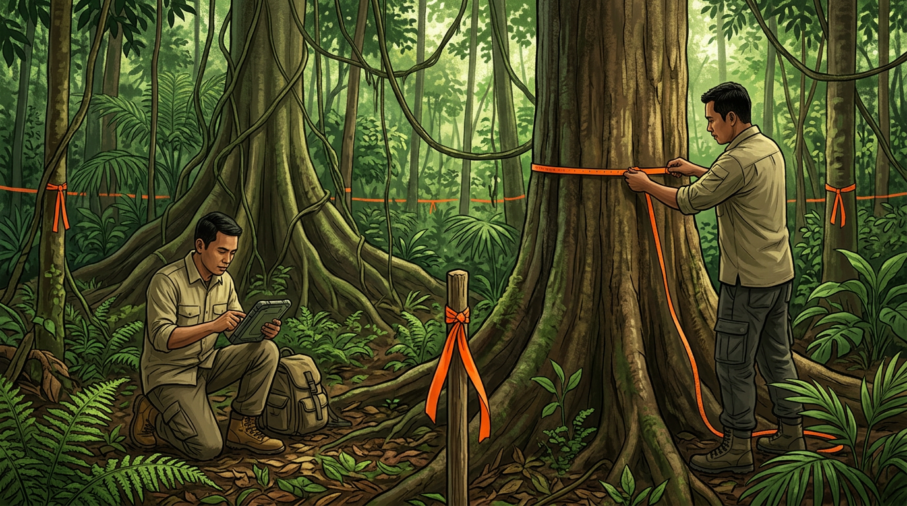

# Plot Lapangan, Kunci Kalibrasi

## Kenapa Drone Tetap Butuh Data Lapangan

Banyak pilot drone berharap bisa menghitung karbon tanpa masuk hutan sama sekali. Sayangnya, itu belum mungkin kalau kamu ingin angkanya bisa dipercaya.

Dari foto drone kita mendapatkan **jumlah pohon, tinggi, dan lebar tajuk**. Rumus biomassa butuh **diameter batang dan berat jenis kayu**, dan dua hal ini tidak terlihat dari atas. Plot lapangan adalah jembatan antara dua dunia itu.

Plot punya tiga tugas:

1. **Kalibrasi.** Mencari hubungan antara ukuran yang terlihat dari udara (tinggi, tajuk) dan diameter atau biomassa (Bab 8).
2. **Validasi tree counting.** Membandingkan jumlah pohon hasil deteksi dengan jumlah pohon sebenarnya (Bab 7).
3. **Koreksi pohon yang tidak terlihat.** Pohon kecil di bawah tajuk pohon besar tidak terlihat dari udara. Plot memberi tahu seberapa besar porsi biomassa yang "tersembunyi" itu (Bab 9).

Kabar baiknya, kamu butuh jauh lebih sedikit plot dibanding inventarisasi penuh. Kalau plot dirancang dengan benar, sedikit data lapangan bisa mengalibrasi ribuan pohon hasil hitungan drone.

## Merancang Plot: Bentuk, Ukuran, dan Jumlah

**Bentuk.** Ada dua pilihan umum:

- **Plot lingkaran.** Mudah dibuat: cukup satu titik pusat dan seutas meteran. Plot lingkaran 0,1 ha punya jari-jari **17,84 m**.
- **Plot persegi atau persegi panjang.** Lebih mudah dicocokkan dengan grid raster. Di Indonesia, **SNI 7724:2011** tentang pengukuran cadangan karbon hutan memakai plot bersarang, yaitu plot besar dengan subplot lebih kecil untuk pohon berukuran lebih kecil.

**Ukuran.** Untuk kalibrasi drone, plot sebaiknya cukup besar supaya berisi beberapa tajuk utuh. Plot **0,05–0,1 ha** adalah ukuran yang umum. Plot yang terlalu kecil membuat banyak tajuk terpotong di batas plot, sehingga sulit dicocokkan dengan hasil deteksi drone.

**Jumlah dan penyebaran.** Patokan awal yang aku pakai adalah **15–30 plot untuk setiap tipe tutupan hutan**, misalnya hutan primer, bekas tebangan, dan semak belukar. Lalu:

- **Sebar plot di seluruh rentang kondisi**: tajuk rapat dan jarang, pohon besar dan kecil, lereng dan datar. Model kalibrasi hanya bisa dipercaya di rentang data yang dia "lihat".
- **Hindari memilih plot hanya di tempat yang mudah dijangkau**, misalnya tepi jalan. Plot yang semuanya di tepi jalan akan mewakili tepi jalan, bukan hutannya.
- **Taruh plot di area yang sudah atau akan difoto drone.** Kedengarannya jelas, tapi sering terlewat.

## Mengukur Pohon dengan Benar

Setiap pohon di dalam plot di atas batas diameter minimum (misalnya 10 cm) diukur. Ini aturan dasarnya:

**Diameter setinggi dada (DBH)** diukur pada ketinggian **1,3 m** dari tanah dengan pita diameter. Beberapa kasus khusus:

| Kondisi | Cara mengukur |
| --- | --- |
| Pohon di lereng | Ukur 1,3 m dari tanah di **sisi atas lereng** |
| Pohon berbanir (akar papan) | Ukur sekitar **30 cm di atas ujung banir** |
| Batang bercabang di bawah 1,3 m | Hitung dan ukur sebagai **dua pohon** |
| Batang miring | Ukur 1,3 m **sepanjang batang**, bukan tegak lurus dari tanah |
| Ada benjolan di 1,3 m | Ukur sedikit di atas atau di bawah benjolan |

Tulis keterangan setiap kali kamu memakai aturan khusus. Konsistensi lebih penting dari kesempurnaan.

**Tinggi pohon** diukur dengan clinometer atau hypsometer. Tinggi pohon di hutan rapat sulit diukur karena puncaknya tertutup. Ukur tinggi pada sebagian pohon dengan teliti daripada semua pohon dengan asal-asalan.

**Jenis pohon** dicatat sedetail mungkin, minimal sampai marga. Jenis menentukan **berat jenis kayu**. Kalau tidak tahu jenisnya, catat nama lokal dan ambil foto daun dan kulit batang.

**Posisi tajuk** juga perlu dicatat: apakah tajuknya **terlihat dari atas** (dominan atau kodominan) atau **tertutup pohon lain** (tertekan). Informasi ini sangat penting untuk menghitung pohon yang tidak terdeteksi drone (Bab 9).

## Mencatat Data Supaya Bisa Dicocokkan dengan Foto

Data plot hanya berguna kalau bisa dicocokkan dengan hasil drone. Kuncinya adalah **posisi**.

1. **Ukur koordinat pusat plot** dengan GNSS RTK Emlid Reach RS4 Pro. Di bawah tajuk rapat sinyal satelit bisa melemah, jadi rekam beberapa menit dan pastikan statusnya *fix* sebelum menyimpan titik. Kalau belum punya receiver RTK dan hanya ada GPS handheld, rata-ratakan posisi beberapa menit, dan sadari bahwa di bawah tajuk akurasinya bisa meleset beberapa meter.
2. **Catat posisi setiap pohon relatif terhadap pusat plot**: arah (azimut dari kompas) dan jarak (meter). Dari dua angka ini, koordinat setiap pohon bisa dihitung.
3. **Beri setiap pohon ID unik**, misalnya `P07-T15` untuk plot 7 pohon 15.

Contoh format tabel yang aku pakai:

| ID pohon | Plot | Azimut (°) | Jarak (m) | DBH (cm) | Tinggi (m) | Jenis | Berat jenis | Posisi tajuk | Catatan |
| --- | --- | --- | --- | --- | --- | --- | --- | --- | --- |
| P07-T15 | P07 | 125 | 8,4 | 42,5 | 27 | Shorea sp. | 0,55 | Dominan | Banir, ukur 30 cm di atas banir |
| P07-T16 | P07 | 140 | 11,2 | 14,0 | – | Tidak diketahui | – | Tertekan | Foto daun: IMG_2231 |

Simpan data dalam format digital (spreadsheet atau CSV) **pada hari yang sama**. Data di buku catatan yang basah kena hujan adalah data yang hilang.

Dengan data udara dari Bab 4 dan data darat dari bab ini, bahan mentahmu sudah lengkap. Saatnya mengolah ribuan foto menjadi model tinggi tajuk.

## Kesimpulan Bab

- Drone tidak bisa melihat **diameter dan berat jenis kayu**, jadi plot lapangan tetap wajib. Fungsinya untuk **kalibrasi**, **validasi tree counting**, dan **koreksi pohon tersembunyi**.
- Pakai plot **0,05–0,1 ha** (lingkaran 0,1 ha = jari-jari **17,84 m**), sekitar **15–30 plot per tipe tutupan**, dan sebar di seluruh rentang kondisi hutan.
- Ukur **DBH di 1,3 m** dengan aturan khusus untuk lereng, banir, cabang, dan batang miring. Catat juga **tinggi, jenis, dan posisi tajuk**.
- Catat **koordinat pusat plot** serta **azimut dan jarak** setiap pohon, supaya bisa dicocokkan dengan hasil drone.
- Simpan data dalam format digital **di hari yang sama**.
