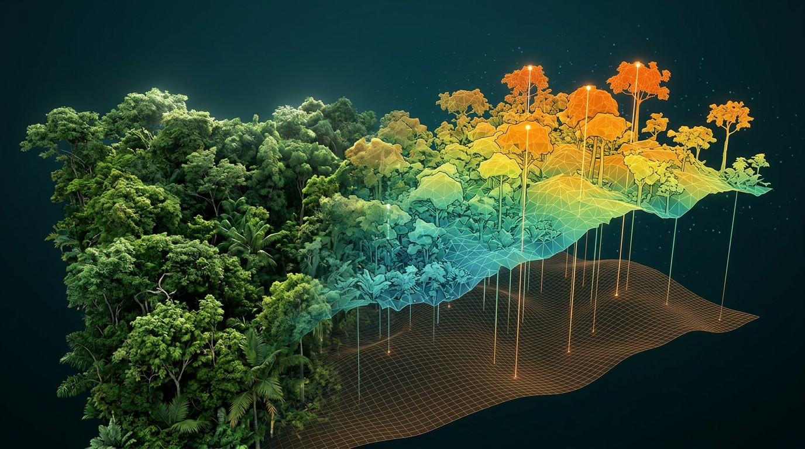

# Mengolah Foto Jadi Ortofoto, DSM, DTM, dan CHM

## Alur Fotogrametri di Metashape

Fotogrametri mengubah ribuan foto 2D menjadi model 3D. Dari model itu kita mendapatkan dua produk utama:

- **Ortofoto**: foto udara mosaik yang sudah tegak lurus dan berkoordinat, seperti peta.
- **DSM** (*Digital Surface Model*): peta ketinggian permukaan teratas, yaitu puncak tajuk pohon, atap, dan tanah terbuka.

Ini alur dasarnya di **Agisoft Metashape**. Nama menu bisa sedikit berbeda antarversi, tapi urutannya sama.

1. **Add Photos.** Masukkan semua foto dari satu area. Periksa foto yang buram atau terlalu gelap, lalu buang.
2. **Align Photos.** Pakai akurasi **High**. Langkah ini mencari titik yang sama di banyak foto dan menghitung posisi kamera. Di hutan, cek persentase foto yang berhasil disejajarkan. Kalau banyak yang gagal, biasanya overlap kurang atau tajuk bergerak.
3. **Masukkan GCP dan optimasi kamera.** Tandai GCP di foto, lalu jalankan **Optimize Cameras**. Catat kesalahan GCP dan check point untuk laporan.
4. **Build Point Cloud** (dulu disebut *Dense Cloud*). Pakai kualitas **Medium** atau **High**, dengan **depth filtering Mild** supaya detail tajuk tidak ikut terbuang.
5. **Build DEM** dari point cloud. Hasilnya adalah **DSM**.
6. **Build Orthomosaic** di atas DSM.
7. **Export** DSM dan ortofoto sebagai **GeoTIFF**, dengan sistem koordinat yang sama.

Proses ini bisa makan waktu berjam-jam untuk ratusan hektar. Jalankan semalaman, dan pastikan laptop tidak masuk mode tidur.

> **Tips:** Simpan proyek Metashape setelah setiap langkah. Kalau listrik padam di tengah proses point cloud, kamu tidak perlu mengulang dari awal.

## Masalah Besar di Hutan: Tanahnya Tidak Kelihatan

Untuk mengetahui tinggi pohon, kita butuh dua hal: **ketinggian puncak tajuk** (dari DSM) dan **ketinggian tanah di bawahnya** (dari **DTM**, *Digital Terrain Model*).

Di sinilah fotogrametri punya kelemahan terbesar. Kamera hanya bisa melihat apa yang terkena cahaya. Di hutan rapat, tanah tertutup tajuk hampir di semua tempat. Berbeda dengan LiDAR yang lasernya bisa menembus celah daun, fotogrametri tidak punya cara langsung untuk melihat tanah di bawah pohon.

Jadi DTM harus diambil dari sumber lain. Pilihannya:

| Sumber DTM | Kelebihan | Kekurangan |
| --- | --- | --- |
| **Titik tanah di celah tajuk** (Classify Ground Points di Metashape, lalu interpolasi) | Dari data yang sama, resolusi tinggi | Hanya bagus kalau banyak celah, misalnya hutan jarang atau kebun |
| **DTM dari LiDAR** (data lama atau survei terpisah) | Paling akurat di hutan rapat | Mahal kalau harus survei LiDAR |
| **DEMNAS** dari BIG (resolusi sekitar 8 m) | Gratis, mencakup seluruh Indonesia | Resolusi kasar; di beberapa lokasi bisa masih mengandung tinggi vegetasi |
| **Model tanah dari GNSS lapangan** (titik di plot dan jalan) | Akurat di titik ukur | Jarang, butuh interpolasi |

Untuk hutan tanaman atau kebun dengan banyak celah, cara pertama sering sudah cukup. Untuk hutan alam rapat, **DTM LiDAR** adalah pilihan terbaik kalau tersedia. Kalau tidak ada, DEMNAS bisa dipakai dengan catatan bahwa tinggi pohon absolut punya ketidakpastian lebih besar, dan harus dicek dengan tinggi pohon yang diukur di plot.

Apa pun sumbernya, **tulis sumber DTM di laporan**. Ini salah satu hal pertama yang ditanyakan pemeriksa.

## Membuat CHM: Tinggi Pohon dari Selisih Dua Model

Setelah punya DSM dan DTM, membuat **CHM** (*Canopy Height Model*, model tinggi tajuk) sebenarnya sangat sederhana:

> **CHM = DSM − DTM**

Setiap piksel CHM menunjukkan tinggi permukaan di atas tanah. Di puncak pohon, nilainya adalah tinggi pohon. Di tanah terbuka, nilainya mendekati nol.

Langkah di **QGIS**:

1. **Samakan grid.** DSM dan DTM harus punya sistem koordinat, ukuran piksel, dan posisi grid yang sama. Kalau DTM-mu lebih kasar (misalnya DEMNAS 8 m), *resample* dulu ke ukuran piksel DSM dengan metode **bilinear**.
2. **Hitung selisih** di **Raster Calculator**: `"DSM@1" - "DTM@1"`.
3. **Bersihkan nilai aneh.** Nilai negatif kecil (misalnya −1 m) wajar karena kesalahan kecil di kedua model. Ubah menjadi 0. Nilai yang terlalu tinggi, misalnya 90 m di hutan yang pohon tertingginya 50 m, adalah artefak. Tandai dan periksa.
4. **Haluskan sedikit** (opsional) dengan filter 3 × 3 piksel. Tajuk yang terlalu "berduri" bisa membuat satu pohon terdeteksi sebagai banyak puncak di Bab 7.

Untuk tree counting, CHM dengan ukuran piksel **10–50 cm** biasanya sudah cukup. Tidak perlu memakai resolusi asli DSM 3 cm, karena hanya membuat proses berikutnya jauh lebih lambat.

## Cek Kualitas Hasil Olahan

Sebelum lanjut ke tree counting, luangkan 30 menit untuk memeriksa hasil olahan. Masalah yang ditemukan sekarang jauh lebih murah dibanding yang ditemukan setelah laporan selesai.

**Ortofoto**
- Apakah ada area buram atau "meleleh"? Biasanya akibat angin atau overlap kurang.
- Apakah ada garis sambungan antarfoto yang mencolok dan memotong tajuk?

**DSM dan CHM**
- Apakah ada **lubang** (area tanpa data)? Lubang sering muncul di tajuk yang bergerak atau di permukaan air.
- Apakah **tinggi pohon masuk akal**? Bandingkan tinggi CHM di posisi pohon plot dengan tinggi yang diukur di lapangan. Selisih rata-rata beberapa meter masih wajar. Selisih belasan meter berarti ada masalah pada DTM.
- Apakah **tepi area** jauh lebih buruk dari bagian tengah? Kalau ya, potong area tepi dari analisis.

Catat semua temuan. Bagian yang kualitasnya buruk bisa dikeluarkan dari analisis atau ditandai di laporan.

Sekarang kamu punya peta ketinggian tajuk untuk seluruh hutan. Di bab berikutnya, peta ini kita pakai untuk melakukan hal yang jadi inti buku ini: menghitung pohon satu per satu dari udara.

## Kesimpulan Bab

- Alur Metashape: **Align Photos → GCP + Optimize → Build Point Cloud → Build DEM (DSM) → Build Orthomosaic → Export GeoTIFF.** Pakai depth filtering **Mild** untuk tajuk.
- Fotogrametri **tidak bisa melihat tanah di bawah tajuk rapat**. DTM diambil dari titik tanah di celah tajuk, **LiDAR**, **DEMNAS**, atau titik GNSS lapangan. Selalu tulis sumbernya.
- **CHM = DSM − DTM.** Samakan grid, hitung selisih di Raster Calculator, ubah nilai negatif kecil jadi 0, dan periksa nilai yang terlalu tinggi.
- CHM dengan piksel **10–50 cm** sudah cukup untuk tree counting.
- **Cek kualitas** ortofoto, DSM, dan CHM, terutama dengan membandingkan tinggi CHM dan tinggi pohon di plot, sebelum lanjut ke tree counting.
