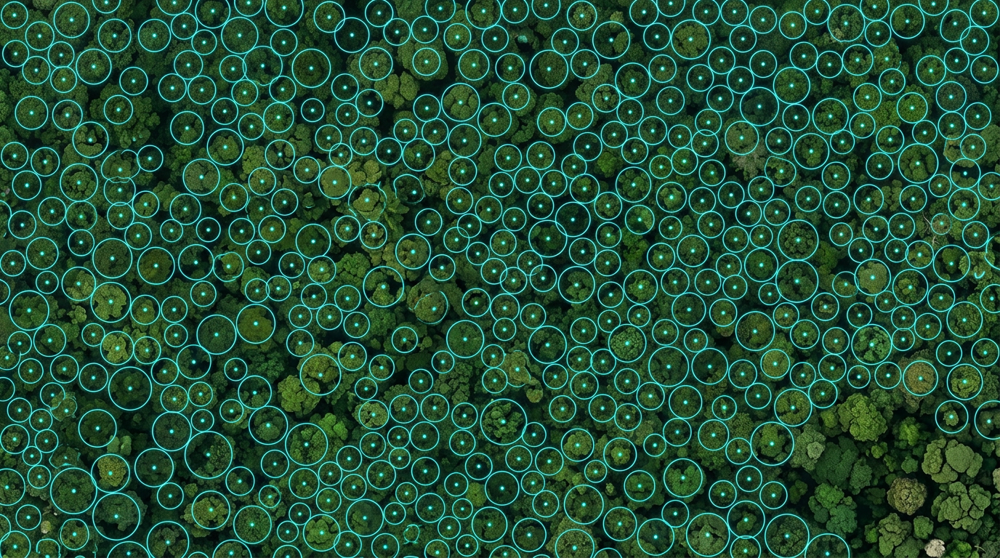

# Tree Counting, Menghitung Pohon dari Udara



## Tiga Cara Menghitung Pohon

Inilah inti buku ini. Dari ortofoto dan CHM, kita ingin tahu **berapa banyak pohon, di mana posisinya, seberapa tinggi, dan seberapa lebar tajuknya.**

Ada tiga cara utama untuk melakukannya:

| Cara | Data yang dipakai | Cocok untuk | Kelemahan |
| --- | --- | --- | --- |
| **Puncak lokal (local maxima)** | CHM | Hutan alam dan hutan tanaman dengan tajuk yang jelas puncaknya | Satu pohon bertajuk lebar bisa terhitung dua; pohon kecil di sela tajuk besar bisa terlewat |
| **Segmentasi tajuk** | CHM + titik puncak | Mendapatkan lebar dan luas tajuk setiap pohon | Batas tajuk yang saling menyatu sulit dipisahkan |
| **Deteksi AI** (misalnya DeepForest) | Ortofoto RGB | Kebun dan hutan tanaman dengan tajuk berpola, atau saat CHM kurang bagus | Perlu dicek dan kadang dilatih ulang untuk tipe hutan lokal |

Di praktik, aku paling sering memakai **puncak lokal untuk menemukan pohon**, lalu **segmentasi tajuk untuk mengukur lebarnya**. Deteksi AI aku pakai sebagai pembanding, atau sebagai metode utama di kebun yang pohonnya tertanam teratur seperti sawit dan karet.

Prinsip dasarnya sama untuk semua cara: **satu pohon = satu objek terdeteksi**, dan setiap objek punya posisi, tinggi, dan lebar tajuk.

## Praktik: Deteksi Puncak Pohon di CHM

Logika metode puncak lokal sederhana. Di CHM, puncak setiap pohon adalah titik yang **lebih tinggi dari semua piksel di sekitarnya**. Kita "menggeser jendela" ke seluruh CHM, dan setiap kali piksel di tengah jendela adalah yang tertinggi, piksel itu dianggap puncak pohon.

Ada tiga pengaturan yang menentukan hasilnya.

**1. Ukuran jendela.** Jendela terlalu kecil membuat satu tajuk besar terdeteksi sebagai beberapa pohon (*over-detection*). Jendela terlalu besar membuat pohon-pohon kecil yang berdekatan tergabung jadi satu (*under-detection*). Solusinya adalah **jendela yang ukurannya berubah sesuai tinggi**: pohon tinggi biasanya bertajuk lebar, jadi jendelanya dibuat lebih besar.

Di paket **lidR** (bahasa R), contohnya seperti ini:

```r
library(lidR); library(terra)
chm <- rast("chm.tif")
ws  <- function(h) { h * 0.1 + 3 }     # lebar jendela (m) bertambah sesuai tinggi
pohon <- locate_trees(chm, lmf(ws = ws, hmin = 5))
```

Angka `0.1` dan `3` di fungsi jendela hanyalah titik awal. Sesuaikan dengan hutanmu dengan membandingkan hasilnya di plot lapangan.

**2. Tinggi minimum.** Abaikan puncak yang terlalu rendah, misalnya di bawah **5 m**, karena biasanya semak atau tumbuhan bawah, bukan pohon.

**3. Penghalusan CHM.** CHM yang kasar membuat banyak puncak palsu di satu tajuk. Penghalusan ringan (Bab 6) mengurangi masalah ini.

Hasil langkah ini adalah **layer titik**, satu titik per pohon, lengkap dengan koordinat dan tinggi pohon dari CHM. Buka di QGIS di atas ortofoto, lalu periksa secara visual di beberapa lokasi. Matamu adalah alat validasi pertama.

## Menggambar Batas Tajuk

Titik puncak memberi kita jumlah dan tinggi pohon. Tapi untuk biomassa kita juga butuh **lebar tajuk**, karena lebar tajuk berhubungan erat dengan diameter batang (Bab 8).

Segmentasi tajuk membagi CHM menjadi poligon-poligon, satu poligon untuk setiap pohon, dengan titik puncak sebagai "benih". Algoritmanya "menumbuhkan" tajuk dari puncak ke arah luar sampai bertemu tajuk tetangga atau turun di bawah tinggi tertentu.

Di lidR, salah satu caranya:

```r
tajuk <- dalponte2016(chm, pohon)()          # raster ID tajuk
poligon <- as.polygons(tajuk)                 # ubah jadi poligon
```

Dari setiap poligon kita hitung:

- **Luas tajuk** (m²)
- **Diameter tajuk** (m), biasanya dihitung sebagai diameter lingkaran dengan luas yang sama: `2 × √(luas ÷ 3,14)`

Gabungkan hasilnya menjadi satu **tabel pohon**: ID, koordinat, tinggi, luas tajuk, dan diameter tajuk. Tabel inilah bahan utama perhitungan biomassa di bab berikutnya.

> **Tips:** Buang poligon yang terpotong batas area atau terlalu kecil, misalnya di bawah 2 m². Biasanya itu sisa tepi atau noise, bukan pohon.

## Menguji Akurasi: Precision, Recall, dan F-score

Hasil tree counting tidak boleh langsung dipercaya. Kita harus membuktikan seberapa akurat hasilnya, dan di sinilah data plot dari Bab 5 berperan.

Cocokkan pohon hasil deteksi dengan pohon di plot yang **tajuknya terlihat dari atas** (dominan dan kodominan). Pohon dianggap cocok kalau posisinya berdekatan, misalnya dalam radius 2–3 m, dan tingginya mirip. Lalu hitung:

- **TP (true positive)**: pohon terdeteksi dan memang ada
- **FP (false positive)**: terdeteksi, tapi sebenarnya bukan pohon terpisah
- **FN (false negative)**: pohon ada, tapi tidak terdeteksi

Dari tiga angka itu:

> **Precision = TP ÷ (TP + FP)**: dari semua yang terdeteksi, berapa persen yang benar
>
> **Recall = TP ÷ (TP + FN)**: dari semua pohon yang ada, berapa persen yang terdeteksi
>
> **F-score = 2 × Precision × Recall ÷ (Precision + Recall)**: nilai gabungan keduanya

**Contoh:** di seluruh plot ada 120 pohon dengan tajuk terlihat. Deteksi menemukan 110 objek, dan 95 di antaranya cocok dengan pohon plot. Maka TP = 95, FP = 110 − 95 = 15, dan FN = 120 − 95 = 25.

- Precision = 95 ÷ 110 = **0,86**
- Recall = 95 ÷ 120 = **0,79**
- F-score = **0,83**

Artinya sekitar 86% deteksi benar, dan 79% pohon yang terlihat berhasil ditemukan. Untuk hutan alam tropis yang rapat, F-score di sekitar 0,7–0,9 sudah tergolong baik. Di hutan tanaman yang teratur, angkanya biasanya lebih tinggi.

Kalau precision rendah, kemungkinan jendela terlalu kecil. Kalau recall rendah, jendela terlalu besar atau tinggi minimum terlalu tinggi. Sesuaikan pengaturannya, ulangi, dan catat pengaturan terbaik di laporan.

Sekarang kamu punya tabel berisi ribuan pohon dengan tinggi dan lebar tajuknya masing-masing. Satu hal yang masih kurang adalah diameter batangnya. Itu yang kita kejar di Bab 8.

## Kesimpulan Bab

- Ada tiga cara utama tree counting: **puncak lokal di CHM**, **segmentasi tajuk**, dan **deteksi AI dari ortofoto**. Kombinasi puncak lokal + segmentasi adalah pilihan kuat untuk hutan.
- Kunci metode puncak lokal adalah **jendela yang menyesuaikan tinggi pohon**, **tinggi minimum** (misalnya 5 m), dan **CHM yang dihaluskan ringan**.
- Segmentasi tajuk menghasilkan **luas dan diameter tajuk**. Gabungkan semuanya dalam satu **tabel pohon**.
- Uji akurasi dengan plot memakai **precision, recall, dan F-score**. Contoh: TP 95, FP 15, FN 25 memberi F-score **0,83**.
- Atur ulang parameter berdasarkan hasil uji, dan **catat pengaturan terbaik** di laporan.
