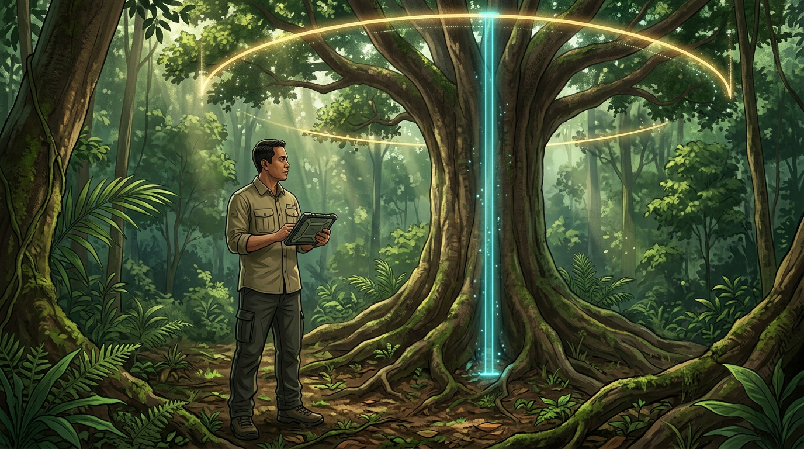

# Dari Tinggi dan Tajuk ke Biomassa

## Masalahnya: Drone Tidak Bisa Melihat Diameter

Sampai sini kamu punya tabel pohon dari udara: posisi, **tinggi (H)**, dan **diameter tajuk (CD)**. Rumus Chave dari Bab 2 butuh **diameter batang (D)** dan **berat jenis kayu (ρ)**. Dua ukuran ini tidak kelihatan dari atas.

Untungnya, ukuran pohon saling berhubungan. Pohon yang batangnya besar biasanya juga tinggi dan bertajuk lebar, karena batang harus cukup kuat menopang tajuknya. Hubungan ini tidak sempurna, tapi cukup kuat untuk dijadikan model.

Jadi strateginya:

1. Di plot lapangan, kita punya pohon yang **D, H, dan CD-nya diketahui sekaligus** (D dan H diukur di lapangan, CD dari segmentasi tajuk drone).
2. Dari pohon-pohon itu kita buat **model D dari H dan CD**.
3. Model itu kita pakai untuk **menaksir D semua pohon** hasil tree counting.
4. Setelah D diketahui, kita hitung **biomassa** dengan persamaan alometrik.

Ada juga pendekatan lain yang tidak lewat diameter, yaitu memodelkan **biomassa per hektare langsung dari statistik CHM** (misalnya tinggi rata-rata tajuk di setiap plot). Cara ini disebut pendekatan berbasis area. Pendekatan ini bagus untuk area luas, tapi buku ini fokus pada pendekatan **per pohon**, karena sejalan dengan tree counting dan hasilnya bisa dicek pohon demi pohon.

## Membangun Model dari Data Plot

Bentuk model yang banyak dipakai menggabungkan tinggi dan diameter tajuk menjadi satu ukuran, yaitu **H × CD**. Penelitian global Jucker dan kawan-kawan (2017) menunjukkan bahwa diameter batang bisa ditaksir cukup baik dari gabungan tinggi dan lebar tajuk ini.

Modelnya biasanya ditulis dalam bentuk logaritma supaya hubungannya lurus:

> **ln(D) = a + b × ln(H × CD)**

Nilai **a** dan **b** dicari dari data plot dengan regresi linear. Kamu bisa melakukannya di Excel atau Google Sheets:

1. Buat kolom **x = LN(H × CD)** dan **y = LN(D)** untuk setiap pohon plot yang tajuknya terdeteksi.
2. Gunakan `=INTERCEPT(y; x)` untuk **a** dan `=SLOPE(y; x)` untuk **b**.
3. Hitung juga **R²** (`=RSQ(y; x)`) dan galat baku sisaan, untuk melihat seberapa kuat modelnya.

**Contoh ilustrasi:** misalkan dari data plot kamu mendapat a = 0,5 dan b = 0,6. Untuk pohon dengan H = 25 m dan CD = 10 m:

- H × CD = 250, dan ln(250) ≈ 5,52
- ln(D) = 0,5 + 0,6 × 5,52 ≈ 3,81
- D = e^3,81 ≈ **45 cm**

Angka a dan b di contoh ini **hanya ilustrasi**. Setiap hutan punya nilainya sendiri, karena itulah kita membuat plot. Jangan memakai koefisien dari hutan lain tanpa mengujinya dengan data lapangan di hutanmu.

> **Tips:** Model berbentuk logaritma cenderung sedikit meremehkan nilai saat dikembalikan ke skala asli. Kalikan hasil D dengan faktor koreksi **e^(SE²/2)**, dengan SE adalah galat baku sisaan model. Faktor ini biasanya hanya beberapa persen, tapi membuat hasilmu lebih jujur.

## Menghitung Biomassa Tiap Pohon

Setelah model siap, langkahnya tinggal diulang untuk setiap baris di tabel pohon:

1. Hitung **D** dari H dan CD dengan model di atas.
2. Tentukan **ρ** (berat jenis kayu), lihat subbab berikutnya.
3. Hitung **AGB = 0,0673 × (ρ × D² × H)^0,976**.

Melanjutkan contoh tadi, dengan D = 45,3 cm, H = 25 m, dan ρ = 0,6 g/cm³:

AGB = 0,0673 × (0,6 × 45,3² × 25)^0,976 ≈ **1.615 kg**

Di spreadsheet, semua ini cukup dengan beberapa kolom rumus. Kalau tabel pohonmu berisi puluhan ribu baris, Python atau R akan jauh lebih nyaman, tapi logikanya tetap sama persis.

Sebelum lanjut, **periksa hasilnya di plot**. Jumlahkan biomassa hasil drone untuk pohon-pohon di setiap plot, lalu bandingkan dengan biomassa yang dihitung langsung dari data lapangan. Kalau hasil drone konsisten lebih tinggi atau lebih rendah, ada yang perlu diperbaiki: modelnya, berat jenisnya, atau tinggi dari CHM.

## Berat Jenis Kayu Saat Jenis Pohon Tidak Diketahui

Masalah berikutnya: dari udara kita tidak tahu jenis setiap pohon, jadi kita juga tidak tahu berat jenis kayunya. Padahal berat jenis bisa berbeda jauh. Kayu ringan mungkin di bawah 0,4 g/cm³, sedangkan kayu sangat keras bisa di atas 0,9 g/cm³.

Pilihan yang praktis:

| Cara | Kapan dipakai |
| --- | --- |
| **Rata-rata berat jenis dari plot**, diberi bobot luas bidang dasar (pohon besar lebih berpengaruh) | Pilihan utama untuk hutan alam campuran |
| **Berat jenis per tipe tutupan** (misalnya hutan primer vs bekas tebangan) | Kalau area terbagi ke beberapa tipe hutan yang jelas berbeda |
| **Berat jenis satu jenis** | Hutan tanaman atau kebun monokultur yang jenisnya sudah pasti |

Rata-rata berbobot dari plot lebih baik daripada rata-rata biasa, karena karbon hutan didominasi pohon besar. Jenis pohon kecil yang jumlahnya banyak tapi biomassanya sedikit tidak seharusnya menentukan berat jenis seluruh hutan.

Apa pun pilihanmu, **tulis nilai berat jenis yang dipakai, cara mendapatkannya, dan sumbernya**. Berat jenis sering menjadi sumber ketidakpastian terbesar kedua setelah diameter.

Sekarang setiap pohon di tabelmu punya angka biomassa. Langkah terakhir adalah menjumlahkannya menjadi stok karbon seluruh area, lengkap dengan seberapa yakin kita pada angka itu.

## Kesimpulan Bab

- Drone memberi **tinggi (H)** dan **diameter tajuk (CD)**, tapi tidak memberi diameter batang (D). Kita menaksir D dengan **model dari data plot**.
- Bentuk model yang umum: **ln(D) = a + b × ln(H × CD)**. Nilai a dan b dicari dengan regresi dari data plot di hutanmu sendiri, dan jangan meminjam koefisien hutan lain tanpa diuji.
- Biomassa tiap pohon dihitung dengan **D hasil model + persamaan alometrik**. Contoh ilustrasi: H 25 m dan CD 10 m menghasilkan D ±45 cm dan AGB ±1.615 kg.
- **Bandingkan hasil drone dengan hasil lapangan di setiap plot** untuk mendeteksi bias.
- Untuk **berat jenis kayu**, pakai rata-rata berbobot luas bidang dasar dari plot, dan selalu tulis nilai serta sumbernya.
