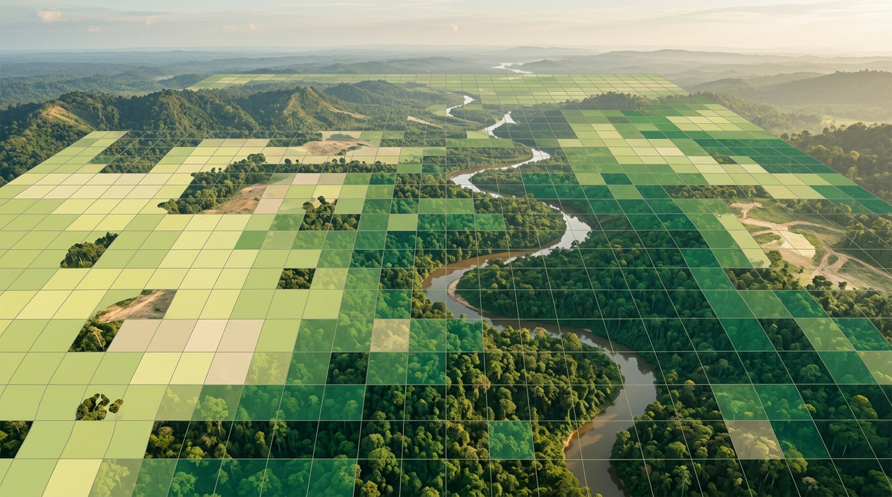

# Stok Karbon Seluruh Area dan Ketidakpastiannya

## Menjumlahkan Karbon Semua Pohon

Setelah setiap pohon punya angka biomassa, langkah berikutnya terasa sederhana: jumlahkan semuanya. Tapi ada beberapa hal yang perlu kamu perhatikan supaya totalnya benar.

**1. Pastikan satuan konsisten.** Biomassa dari rumus alometrik dalam **kg**. Ubah total ke **ton** (dibagi 1.000) sebelum masuk laporan.

**2. Hitung per hektar.** Total biomassa dibagi luas area (ha) menghasilkan **ton biomassa per hektar**. Angka per hektar memudahkan perbandingan dengan hutan lain dan dengan literatur.

**3. Buat peta kepadatan.** Bagi area menjadi grid, misalnya petak 50 × 50 m atau 1 ha. Jumlahkan biomassa pohon di setiap petak, lalu warnai petaknya. Peta ini langsung menunjukkan bagian hutan yang paling kaya karbon dan bagian yang sudah terdegradasi.

**4. Bedakan tipe tutupan.** Kalau area berisi beberapa tipe, misalnya hutan primer, bekas tebangan, dan semak, hitung terpisah untuk setiap tipe. Laporan yang memisahkan tipe tutupan jauh lebih informatif daripada satu angka total.

## Jangan Lupa Biomassa Akar

Sejauh ini kita hanya menghitung **biomassa atas tanah** (AGB). Padahal akar pohon juga menyimpan karbon dalam jumlah yang tidak kecil.

Akar tidak bisa difoto drone dan sangat mahal untuk digali. Karena itu, biomassa bawah tanah (BGB) biasanya dihitung dengan **rasio akar terhadap pucuk** (*root-to-shoot ratio*, R):

> **BGB = AGB × R**

Nilai R tersedia di panduan IPCC untuk berbagai tipe hutan. Untuk **hutan hujan tropis**, IPCC 2006 memberikan nilai **R = 0,37**. Tipe hutan lain punya nilai berbeda, dan untuk beberapa tipe nilainya juga bergantung pada besar biomassa per hektar. Pilih nilai yang sesuai dengan tipe hutanmu, dan tulis sumbernya.

Jadi total biomassa pohon hidup adalah:

> **Biomassa total = AGB + BGB = AGB × (1 + R)**

## Pohon yang Terlewat dan Cara Mengoreksinya

Drone hanya melihat lapisan tajuk paling atas. Pohon yang lebih kecil dan tertutup tajuk pohon besar (pohon tertekan) tidak akan terdeteksi. Pohon-pohon ini tetap menyimpan karbon.

Di sinilah catatan **posisi tajuk** dari Bab 5 menjadi sangat berguna. Di setiap plot, kamu tahu pohon mana yang tajuknya terlihat dari atas dan mana yang tidak. Dari situ kamu bisa menghitung:

> **Faktor koreksi = biomassa semua pohon plot ÷ biomassa pohon plot yang tajuknya terlihat**

Kalau di plot-plotmu pohon yang tidak terlihat menyumbang sekitar 11% dari total biomassa, faktor koreksinya sekitar **1,12**. AGB hasil drone dikalikan faktor ini untuk memperhitungkan pohon yang terlewat.

Faktor koreksi juga bisa sekaligus menyerap kesalahan tree counting (FN dan FP), asalkan dihitung dengan cara yang sama: biomassa lapangan dibagi biomassa hasil drone di plot yang sama.

**Contoh lengkap:** area 100 ha, dengan total AGB dari pohon yang terdeteksi drone sebesar 18.000 ton.

| Langkah | Hitungan | Hasil |
| --- | --- | --- |
| AGB per hektar dari drone | 18.000 ÷ 100 | 180 t/ha |
| Koreksi pohon terlewat | 180 × 1,12 | 201,6 t/ha |
| Tambah akar (R = 0,37) | 201,6 × 1,37 | 276,2 t/ha |
| Karbon | 276,2 × 0,47 | **129,8 t C/ha** |
| CO₂ ekuivalen | 129,8 × 44/12 | **476 t CO₂e/ha** |
| Total area | 476 × 100 ha | **±47.600 t CO₂e** |

Angka 18.000 ton dan faktor 1,12 di contoh ini adalah ilustrasi. Di proyekmu, kedua angka itu berasal dari data drone dan plotmu sendiri.

## Menyatakan Ketidakpastian dengan Jujur

Tidak ada pengukuran karbon yang sempurna. Laporan yang bagus tidak menyembunyikan ini. Laporan yang bagus justru menyatakan **seberapa yakin** kita pada angkanya.

Sumber ketidakpastian utama dalam metode ini:

| Sumber | Contoh penyebab |
| --- | --- |
| Tree counting | Pohon terlewat atau terhitung ganda |
| Tinggi dari CHM | Kesalahan DTM, terutama di hutan rapat |
| Model diameter | Hubungan H × CD dengan D tidak sempurna |
| Persamaan alometrik | Rumus umum tidak persis cocok dengan hutan lokal |
| Berat jenis kayu | Jenis pohon tidak diketahui dari udara |
| Faktor koreksi dan rasio akar | Diambil dari jumlah plot yang terbatas atau nilai standar |

Cara paling sederhana menyatakan ketidakpastian adalah **membandingkan hasil drone dengan hasil lapangan di semua plot**. Hitung selisih relatifnya, lalu gunakan sebarannya untuk membuat rentang. Misalnya, kalau ketidakpastian gabungan sekitar **±15%** pada tingkat kepercayaan 90%, contoh di atas dilaporkan sebagai:

> **Stok karbon: ±47.600 t CO₂e (rentang ±40.500–54.700 t CO₂e, tingkat kepercayaan 90%)**

Untuk proyek yang lebih serius, misalnya proyek karbon yang akan diverifikasi, ketidakpastian biasanya dihitung lebih teliti dengan **simulasi Monte Carlo**. Caranya, perhitungan diulang ribuan kali dengan nilai-nilai masukan yang diacak sesuai ketidakpastiannya masing-masing. Konsepnya sama: menunjukkan rentang yang wajar, bukan satu angka yang terkesan pasti.

Menuliskan rentang tidak membuatmu terlihat kurang ahli. Justru sebaliknya, karena para pemeriksa tahu angka tanpa ketidakpastian hampir selalu berarti ketidakpastiannya belum dihitung.

## Kesimpulan Bab

- Jumlahkan biomassa semua pohon, ubah ke **ton**, hitung **per hektar**, buat **peta kepadatan**, dan pisahkan per **tipe tutupan**.
- Tambahkan **biomassa akar** dengan rasio akar-pucuk. Untuk hutan hujan tropis, IPCC 2006 memberi **R = 0,37**.
- Koreksi **pohon yang tidak terlihat** dengan faktor dari data plot: biomassa semua pohon dibagi biomassa pohon yang tajuknya terlihat.
- Contoh 100 ha: 180 t AGB/ha → 201,6 (koreksi) → 276,2 (+ akar) → **129,8 t C/ha** → **476 t CO₂e/ha**, total **±47.600 t CO₂e**.
- Selalu nyatakan **ketidakpastian** sebagai rentang, misalnya ±15% pada tingkat kepercayaan 90%, dan sebutkan sumber-sumber utamanya.
