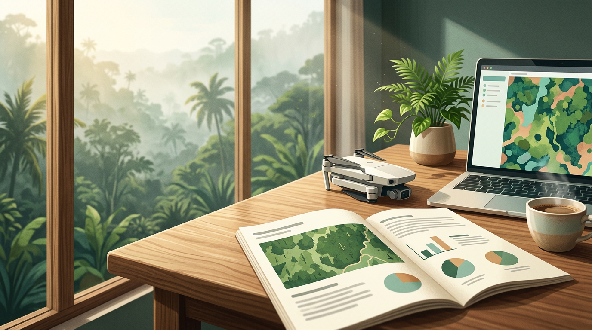

# Laporan Karbon yang Dipercaya dan Langkah Berikutnya

## Isi Wajib Laporan Karbon

Semua kerja kerasmu, dari terbang, plot, olah data, sampai perhitungan, akhirnya dinilai dari satu hal: **laporan**. Klien, pemeriksa, atau lembaga pendanaan biasanya tidak melihat proses kerjamu. Mereka hanya melihat laporannya.

Laporan karbon yang dipercaya menjawab enam pertanyaan:

| Bagian | Pertanyaan yang dijawab |
| --- | --- |
| **1. Ringkasan** | Berapa stok karbonnya, di mana, dan seberapa yakin? |
| **2. Area dan cakupan** | Batas area, luas, tipe tutupan, tanggal survei, dan kolam karbon yang dihitung |
| **3. Data** | Drone dan kamera, parameter terbang, jumlah dan lokasi plot, sumber DTM |
| **4. Metode** | Pengaturan tree counting dan hasil uji akurasinya, model diameter, persamaan alometrik, berat jenis kayu, fraksi karbon, rasio akar, faktor koreksi |
| **5. Hasil** | Total dan per hektare, per tipe tutupan, dalam ton C dan ton CO₂e, beserta rentang ketidakpastian |
| **6. Batasan** | Apa yang tidak dihitung, bagian data yang kurang bagus, dan asumsi yang dipakai |

Bagian **batasan** sering dilewati karena dianggap membuat laporan terlihat lemah. Padahal justru di bagian inilah kepercayaan dibangun. Contoh batasan yang jujur:

- "Karbon tanah, serasah, dan kayu mati tidak termasuk dalam perhitungan ini."
- "DTM berasal dari DEMNAS (resolusi ±8 m), sehingga tinggi pohon di lereng curam punya ketidakpastian lebih besar."
- "Area seluas 4 ha di sisi timur dikeluarkan karena kualitas foto buruk akibat angin."

Sertakan juga **lampiran**: tabel data plot, tabel ringkasan pohon hasil drone, dan file peta (GeoTIFF dan shapefile atau GeoPackage). Lampiran memungkinkan orang lain memeriksa ulang pekerjaanmu.

## Peta dan Visual yang Mudah Dibaca

Satu peta yang baik bisa menjelaskan lebih banyak daripada lima halaman tabel. Peta minimal untuk laporan karbon:

1. **Peta lokasi dan batas area** di atas ortofoto, dengan posisi plot lapangan.
2. **Peta hasil tree counting**: titik pohon atau poligon tajuk di atas ortofoto, untuk satu bagian yang di-zoom sebagai contoh.
3. **Peta kepadatan karbon**: grid berwarna dalam ton C/ha atau ton CO₂e/ha.
4. **Peta tipe tutupan**, kalau area dibagi menjadi beberapa tipe.

Tips membuat peta yang jelas di QGIS:

- Pakai **skema warna berurutan** (misalnya hijau muda ke hijau tua) untuk kepadatan karbon. Hindari warna pelangi yang membingungkan.
- Selalu cantumkan **legenda dengan satuan**, **skala**, **arah utara**, **sistem koordinat**, dan **tanggal data**.
- Tambahkan **grafik sederhana**, misalnya stok karbon per tipe tutupan dalam diagram batang, supaya pembaca nonteknis langsung menangkap intinya.

## Pemantauan Berkala

Satu kali survei memberi gambaran stok karbon **saat ini**. Nilai metode drone semakin terasa saat survei diulang, misalnya setiap tahun atau dua tahun. Dengan begitu kamu bisa melihat **perubahan**: apakah hutan bertambah karbonnya karena tumbuh, atau berkurang karena tebangan dan kebakaran.

Supaya hasil antarwaktu bisa dibandingkan:

- **Ulangi dengan pengaturan yang sama**: tinggi terbang, overlap, kamera, waktu dalam hari, dan sebaiknya musim yang sama.
- **Pakai DTM yang sama** untuk semua periode, supaya perubahan tinggi berasal dari pohon, bukan dari perbedaan model tanah.
- **Pertahankan plot permanen.** Tandai pusat plot dengan patok permanen dan koordinat akurat, lalu ukur ulang pohon-pohon yang sama.
- **Bandingkan per pohon dan per petak.** Pohon yang hilang di antara dua survei langsung terlihat sebagai titik yang lenyap di peta tree counting.

Perubahan stok karbon antarwaktu inilah yang biasanya paling dicari oleh proyek karbon dan program pemantauan hutan.

## Peluang Kerja di Bidang Karbon Hutan

Kemampuan yang kamu pelajari di buku ini dibutuhkan di banyak tempat. Beberapa layanan yang bisa kamu tawarkan:

| Layanan | Calon klien |
| --- | --- |
| **Inventarisasi pohon dan stok karbon** | Perusahaan perkebunan dan kehutanan, pemilik hutan rakyat |
| **Data awal (baseline) proyek karbon** | Pengembang proyek karbon, LSM lingkungan |
| **Pemantauan berkala dan perubahan tutupan** | Pengelola kawasan konservasi, program rehabilitasi hutan dan mangrove |
| **Data pendukung laporan keberlanjutan** | Perusahaan yang menyusun laporan emisi dan CSR |
| **Pelatihan tim internal** | Dinas kehutanan, perusahaan, kampus |

Beberapa hal penting sebelum terjun:

- **Pahami standar yang dipakai klien.** Proyek karbon yang menghasilkan kredit mengikuti metodologi tertentu, misalnya standar internasional seperti Verra, atau aturan nasional dan pencatatan di **Sistem Registri Nasional Pengendalian Perubahan Iklim (SRN PPI)**. Data drone biasanya menjadi bagian pendukung metodologi itu, bukan pengganti seluruhnya.
- **Bermitra.** Bekerja sama dengan ahli kehutanan, tim inventarisasi lapangan, atau konsultan karbon membuat layananmu lebih lengkap dan lebih dipercaya.
- **Mulai dari proyek kecil yang tuntas.** Satu laporan lengkap untuk 20 hektare kebun bisa menjadi portofolio yang meyakinkan untuk proyek berikutnya yang lebih besar.

Kamu memulai buku ini dengan pertanyaan yang bikin bingung: "Hutan ini simpan berapa ton karbon?" Sekarang kamu tahu cara menjawabnya. Mulai dari merencanakan terbang, mengukur plot, membuat CHM, menghitung pohon, mengubahnya jadi biomassa dan karbon, sampai menuliskannya dalam laporan yang jujur.

Jadi lain kali ada yang bertanya, kamu tidak perlu menebak lagi. **Kamu tinggal menghitung.**

## Kesimpulan Bab

- Laporan karbon yang dipercaya berisi **ringkasan, area dan cakupan, data, metode, hasil dengan ketidakpastian, dan batasan**, ditambah lampiran data dan file peta.
- Bagian **batasan** justru membangun kepercayaan. Tulis apa yang tidak dihitung dan bagian data yang kurang bagus.
- Peta minimal: **lokasi dan plot**, **hasil tree counting**, **kepadatan karbon**, dan **tipe tutupan**, lengkap dengan legenda, satuan, skala, dan tanggal.
- **Pemantauan berkala** dengan pengaturan, DTM, dan plot permanen yang sama menunjukkan perubahan stok karbon dari waktu ke waktu.
- Peluang kerjanya luas, dari inventarisasi, data awal proyek karbon, sampai pemantauan. Pahami standar klien, bermitra dengan ahli lain, dan mulai dari **proyek kecil yang tuntas**.
